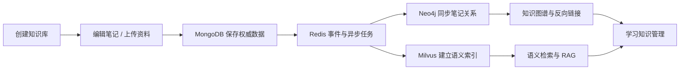
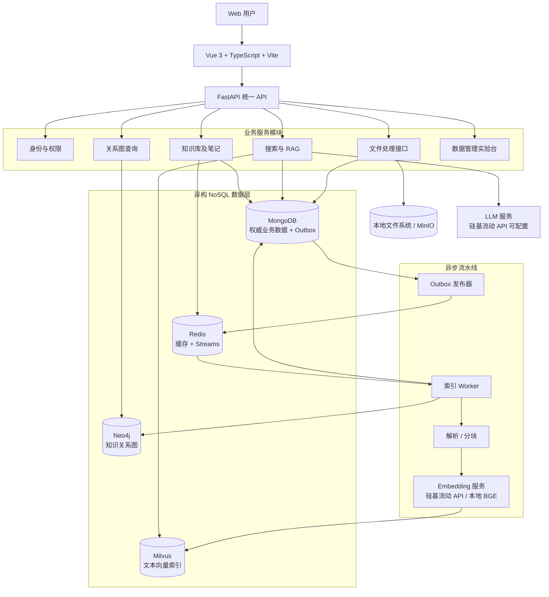
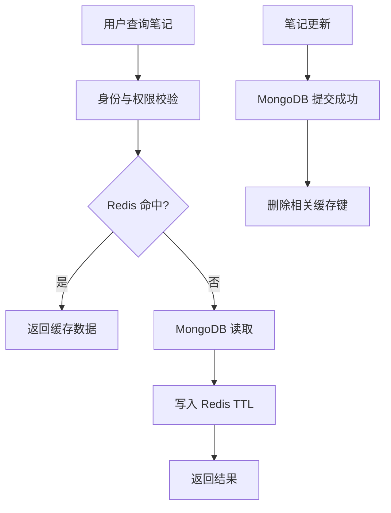
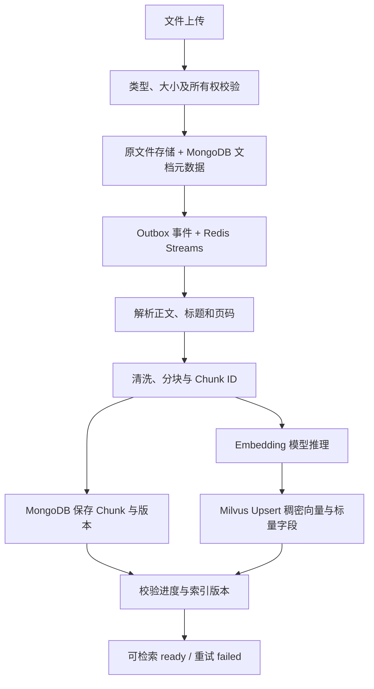
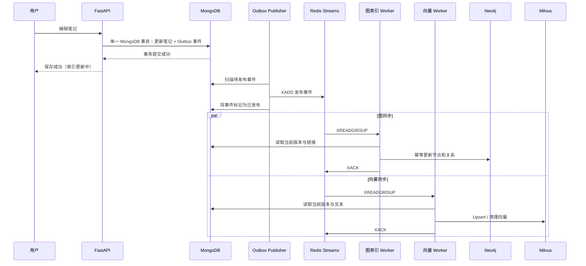

# 基于异构 NoSQL 数据库协同的个人知识管理与智能检索系统

> 产品名称：**知序 KnowledgeHub**

> **项目全称：** 基于异构 NoSQL 数据库协同的个人知识管理与智能检索系统  
> **项目类型：** 《大数据管理》课程设计 / Web 系统 / 异构 NoSQL 数据库协同  
> **文档类型：** 项目总体设计、技术架构与实验实施方案  
> **版本：** V1.2（2026-10-25，Embedding 选型定稿与 RAG 实施方案版）  
> **核心原则：** 产品功能真实可用、数据库各司其职、跨库同步可恢复、实验结果可复现。

---

## 摘要

“知序 KnowledgeHub”面向大学生在课程学习、科研实践与日常生活中的资料积累和知识组织需求，拟开发一套融合 **Obsidian 式 Markdown 笔记与双向链接**、**ima 式资料汇聚与智能检索**的个人知识管理 Web 平台。系统支持知识库创建、Markdown 编辑、标签分类、PDF/DOCX/Markdown 资料导入、笔记关联图谱、关键词和语义检索、基于个人资料的 AI 问答以及知识库统计。

项目在技术上采用 **MongoDB + Redis + Neo4j + Milvus** 的异构 NoSQL 数据库组合：MongoDB 保存具有权威性的业务文档和版本，Redis 实现热点缓存与异步事件分发，Neo4j 组织笔记之间的图结构关系，Milvus 建立文本片段向量索引。后端采用 FastAPI，前端采用 Vue 3 + TypeScript，并通过独立 Worker 完成文档解析、知识关系同步和向量化任务。为处理跨数据库无全局事务的问题，设计 **MongoDB Transactional Outbox + Redis Streams + 幂等 Worker + 版本校验 + 定期对账** 的最终一致性方案。

在课程评价方面，除完整 Web 产品外，重点设计 MongoDB 索引、Redis 缓存、Neo4j 图遍历、Milvus 语义检索和跨数据库故障恢复等可重复实验，使系统同时具备实用性、工程完整性和大数据管理技术深度。

**关键词：** 异构 NoSQL 数据库；Polyglot Persistence；MongoDB；Redis Streams；Neo4j；Milvus；知识图谱；语义检索；RAG；最终一致性。

---

## V1.1 变更摘要

1. 将“多模型 NoSQL”统一更正为 **“异构 NoSQL 数据库协同”**，避免与单一“多模型数据库”概念混淆。
2. 第四种数据库由原有方案切换为 **Milvus**；正式环境建议 Milvus Standalone，使用 PyMilvus SDK。
3. 将向量存储改为 Milvus Collection + Schema（VARCHAR 主键、FLOAT_VECTOR、标量过滤字段），保持 MongoDB 权威数据源原则。
4. 增加 **FLAT / IVF_FLAT / HNSW 索引对比实验**；BM25 与 Dense/Sparse 混合检索作为 P1，需验证中文分词。
5. 更新 Docker 部署、Worker、数据一致性、实验指标、报告标题、术语与参考链接。

---

## V1.2 变更摘要

1. **Embedding 方案定稿：** 采用硅基流动 API + `Qwen/Qwen3-VL-Embedding-8B` 多模态向量模型，文本与图片统一向量空间；新增 §9.8，明确接入要点、维度定稿流程、批量生成与费用预算、可复现性要求。
2. **RAG 实施方案细化：** 第 12 章重写为可实施版本——八步流水线、引用硬约束、证据不足拒答分支、图文混排模型路由、多轮对话、限流与降级，以及 R1—R4 实施步骤与验收标准。
3. 明确硬约束：向量维度实测后写死配置，任何模型/维度变更等同全量重建 Collection 与向量索引。
4. 监控指标补充外部 AI 服务维度（§16.1）；实验 15.4-B 增加 Reranker 精排对照组；附录补充硅基流动与 Qwen3-VL-Embedding 官方链接。
5. LLM / Reranker / Embedding 三个模型项独立配置（同用硅基流动，OpenAI 兼容），核心知识库功能不依赖模型服务在线。

---

# 1. 项目背景与定位

## 1.1 需求背景

大学生常同时接触课件、电子教材、论文、课堂笔记、实验报告、课程项目文档、网页收藏及生活办事资料。常见问题包括：

1. 资料分散在文件夹、网盘、聊天记录和不同笔记软件中，统一管理困难。
2. 文件名无法完整表达内容，资料数量增长后难以快速检索。
3. 笔记间的引用、前置知识与相关概念缺乏结构化管理。
4. 普通关键词检索对表达方式不同但语义相近的问题效果有限。
5. 缺乏对个人知识规模、知识关联和学习资料变化的可视化分析。

因此，本项目既是面向学生的个人知识库应用，也是四类 NoSQL 数据库协同技术的真实实验载体。

## 1.2 竞品借鉴与差异化

| 参考产品 | 可借鉴能力 | 本项目实现重点 |
|---|---|---|
| Obsidian | Markdown、双向链接、反向链接、图谱、标签 | Markdown 编辑器与 Neo4j 知识关系 |
| ima | 资料导入、统一检索、AI 知识问答、来源定位 | 文档解析、Milvus 向量检索与 RAG |
| 传统网盘/文件管理器 | 文件夹、上传下载、分类 | 文件元数据、权限、处理状态 |
| 通用笔记应用 | 笔记 CRUD 和搜索 | 数据库性能、缓存及跨库一致性验证 |

**差异化重点：** 不以完全复刻商业软件为目标，而是形成“真实可用的个人知识库 + 可观测的异构数据库协同系统 + 可重复的数据库性能实验”三位一体成果。

## 1.3 项目目标

### 业务目标

- 支持用户创建多个知识库，管理课程、科研与生活资料。
- 通过 Markdown 笔记、标签、附件和版本历史组织内容。
- 支持笔记双向链接和知识关系可视化。
- 支持 PDF、DOCX、Markdown、TXT 的导入与文本提取。
- 提供精确筛选、语义检索、混合检索及带来源的 AI 问答。
- 展示知识库规模、类型分布、活动趋势及关联网络。

### 数据管理目标

- 清晰划分四种 NoSQL 的职责及数据所有权。
- 实现索引、缓存、图查询、向量检索等各类数据库特性。
- 设计可恢复、幂等、可追踪的跨库异步同步机制。
- 使用规模化合成数据及少量高质量真实数据完成性能评测。
- 保存实验环境、数据生成脚本、原始结果和分析图表。

## 1.4 项目边界与优先级

| 优先级 | 范围 | 说明 |
|---|---|---|
| **P0：课程必须完成** | 用户与知识库、Markdown 笔记、文档上传解析、Redis 缓存与 Streams、Neo4j 双向链接、Milvus 语义检索、性能实验、基本一致性 | 课程交付主体 |
| **P1：优先扩展** | 版本回滚、统一混合检索、RAG 问答、精细任务监控、知识统计大屏 | 有时间继续开发 |
| **P2：长期扩展** | OCR、图片跨模态检索、多人协作、移动端、离线优先与双向同步、自动知识抽取 | 不作为课程硬性交付 |

> 课程项目第一版建议采用“个人空间、默认私有”设计，先不做多人实时协同编辑；这能显著降低并发冲突和权限复杂度。

---

# 2. 典型用户场景与业务流程

## 2.1 场景 A：课程学习

学生建立“操作系统”知识库，上传课件并创建“进程调度”“死锁”“内存管理”等 Markdown 笔记；通过 `[[进程调度]]` 建立关联；复习时在搜索框输入自然语言问题，系统从笔记和 PDF 片段中召回相关内容并定位到原始资料。

## 2.2 场景 B：科研和课程项目

学生将论文、项目报告、技术说明分门别类存放；按主题、标签筛选；利用知识图谱查看不同笔记与概念间的引用关系；通过引用溯源避免只保存 AI 生成结论却无法回到原文。

## 2.3 场景 C：日常生活

学生记录办事流程、课程安排信息、生活经验、收藏的公开资源等。后续可按关键词、标签或语义查找。个人信息和隐私资料默认仅本人可见。

## 2.4 端到端业务链



---

# 3. 总体系统架构

## 3.1 架构选择

采用 **模块化单体 FastAPI + 多数据库适配器 + 独立异步 Worker + Docker Compose**，暂不拆分成大量微服务。

优势：部署和调试成本低；统一身份与权限管理；各数据库职责独立；后续仍可按模块拆分服务。

## 3.2 术语界定：异构 NoSQL 与多模型数据库并不相同

本项目采用 **Heterogeneous NoSQL Databases / Polyglot Persistence（异构 NoSQL 数据库协同 / 多数据库技术混合持久化）**：MongoDB、Redis、Neo4j、Milvus 是四套独立数据库系统，各自管理不同类型的数据和访问模式，通过应用服务与事件机制协作。这里的“异构”强调**独立引擎、不同数据模型与事务边界**，不能将其误称为“一个多模型数据库（Multi-model Database）”。

统一技术表达：**异构 NoSQL 数据库协同架构**。数据库类型分别是文档型、键值/流式数据结构、属性图与向量数据管理。

## 3.3 技术架构图



**关键约束：** 前端不得直连数据库；MongoDB 是笔记、资料、权限与版本信息的权威数据源；Redis、Neo4j、Milvus 主要维护可重建的缓存和派生索引。

## 3.4 各数据库职责矩阵

| 技术 | 数据模型 | 核心职责 | 核心功能 | 课程技术点 |
|---|---|---|---|---|
| MongoDB | 文档 | 权威数据存储 | 用户、知识库、笔记、文件元数据、片段、版本、Outbox | 嵌套文档、聚合、复合索引、事务 |
| Redis | 键值 / 数据结构 / Stream | 热点加速和异步事件 | 热点笔记缓存、会话、限流、排行、Streams | TTL、Hash、Sorted Set、消费者组 |
| Neo4j | 属性图 | 显式关系查询 | 双向链接、反向引用、相邻节点、路径 | Cypher、图约束、图遍历 |
| Milvus | 向量 + 标量字段 | 向量索引及语义/混合检索 | Chunk Embedding、Top-K、用户过滤、BM25（P1） | FLAT / IVF_FLAT / HNSW、Recall@K、延迟 |
| 本地文件 / MinIO | 文件 / 对象 | 大文件存储（非主要 NoSQL 数据库） | PDF、DOCX、图片原件 | 文件路径、哈希、授权下载 |

> 不建议为“凑技术栈”加入 Cassandra、OpenSearch 等更多中间件。若后续需要全文倒排索引，可比较增加 OpenSearch 与利用现有索引的收益和运维成本。

---

# 4. 前后端技术栈和模块组织

## 4.1 前端

| 技术 | 建议用途 |
|---|---|
| Vue 3 + TypeScript + Vite | 单页应用主体 |
| Vue Router | 页面路由 |
| Pinia | 用户、知识库和编辑器状态 |
| Element Plus | 管理页面和通用组件 |
| TipTap | 可扩展笔记编辑器；需明确定义 Markdown 导入导出规则 |
| Cytoscape.js | 知识节点与关系可视化 |
| Apache ECharts | 数据看板和实验结果图 |
| Axios / Fetch | 调用后端 API |

主要页面：

1. 登录 / 注册；
2. 总览 Dashboard；
3. 知识库列表和资料树；
4. 三栏笔记编辑台（目录—编辑区—反向链接）；
5. 文件上传与解析任务；
6. 统一搜索与资料引用；
7. 知识图谱；
8. AI 问答（P1）；
9. 管理员实验台 / 运行监控。

## 4.2 后端

- FastAPI + Pydantic：REST API 和数据校验。
- PyMongo Async API：异步 MongoDB 驱动。新项目不优先采用已弃用的 Motor。
- redis-py：Redis 缓存及 Streams。
- Neo4j Python Driver：Cypher 查询与事务。
- PyMilvus（`pymilvus`）：向量 Collection 管理、过滤和检索。
- PyMuPDF / python-docx：PDF、DOCX 文本解析。
- Embedding：硅基流动 API + `Qwen/Qwen3-VL-Embedding-8B`（多模态，文本/图片统一向量空间），经 `EmbeddingClient` 抽象封装；本地 BGE 系模型保留为离线备选（详见 9.8）。
- Reranker（P1）：`Qwen/Qwen3-VL-Reranker`，RAG 召回后精排，与 Embedding 同平台复用密钥（详见第 12 章）。
- LLM：硅基流动 OpenAI 兼容接口（Qwen3-VL / Qwen3 / DeepSeek 系列可配置，图文混排时路由到 VL 模型）；问答必须具有来源引用（实施详见第 12 章）。
- pytest + httpx：测试；Locust：并发压测。

## 4.3 工程目录建议

```text
knowledgehub/
├── frontend/
│   └── src/
│       ├── api/
│       ├── components/
│       ├── router/
│       ├── stores/
│       └── views/
│           ├── Dashboard/
│           ├── KnowledgeBases/
│           ├── NoteEditor/
│           ├── Documents/
│           ├── Search/
│           ├── KnowledgeGraph/
│           └── SystemLab/
├── backend/
│   ├── app/
│   │   ├── main.py
│   │   ├── api/
│   │   ├── core/           # 配置、认证、安全
│   │   ├── schemas/
│   │   ├── models/
│   │   ├── repositories/   # 各数据库访问封装
│   │   └── services/       # 业务编排
│   └── requirements.txt
├── workers/
│   ├── event_publisher.py
│   ├── document_parser.py
│   ├── graph_indexer.py
│   ├── vector_indexer.py
│   └── reconciliation.py
├── database/
│   ├── mongodb/init_indexes.js
│   ├── neo4j/constraints.cypher
│   └── milvus/init_collection.py
├── benchmarks/
│   ├── generate_data.py
│   ├── benchmark_mongo.py
│   ├── benchmark_redis.py
│   ├── benchmark_graph.py
│   ├── benchmark_vector.py
│   └── benchmark_consistency.py
├── tests/
├── scripts/
├── docs/
├── docker-compose.yml
├── .env.example
└── README.md
```

---

# 5. 业务模块与功能详细设计

## 5.1 用户与知识库管理（P0）

- 注册、登录、登出；个人设置；默认私有的知识库。
- 知识库创建、重命名、分类、删除和归档。
- 权限校验：请求必须关联当前用户；前端隐藏内容不等于后端授权。
- 知识库概览：笔记数量、文档数量、最新修改、标签分布。

**数据库：** MongoDB 维护账户与知识库，Redis 可管理会话/限流以及统计缓存。

## 5.2 Markdown 笔记工作台（P0）

- 新建、编辑、删除、搜索笔记；可选自动保存（防抖）。
- 支持标题、列表、代码块、表格、引用和图片链接等常见编辑能力。
- 标签、笔记属性、知识库内分类。
- 双向链接：通过 `[[标题]]` 交互选取目标笔记，并保存稳定的 `note_id`；显示反向链接。
- 版本历史：修改保存后形成版本快照或差异记录；提供恢复功能（P1）。
- 乐观锁：更新时提交 `content_version`，服务端仅接受匹配版本的更新。

**数据库：** MongoDB 为正文权威源，Neo4j 为链接关系索引，Redis 为热点缓存。

## 5.3 资料导入与文档处理（P0）

- 支持 PDF、DOCX、MD、TXT；图片原件可上传，但 OCR 列入 P2。
- 存储文件原件、文件哈希、MIME 类型、大小、归属用户、知识库、解析状态。
- 自动提取段落、标题、页码或页范围。
- 对正文进行清洗、分块，生成稳定 Chunk ID。
- 异步构建 Milvus 向量索引，界面展示 `uploaded → parsing → indexing → ready` 状态。
- 允许失败重试、删除和重新索引。

**数据库：** MongoDB 文档/Chunk 元数据；Redis Streams 任务；Milvus 向量索引。

## 5.4 统一搜索（P0）

| 模式 | 技术路径 | 用途 |
|---|---|---|
| 元数据检索 | MongoDB 过滤、排序和索引 | 标题、标签、课程、文件类型、日期 |
| 语义检索 | Query Embedding → Milvus Top-K → MongoDB 原文 | 同义表达、概念性查询 |
| 混合检索 | 合并候选、去重、RRF/重排序 | 综合相关性，P1 完善 |

注意：标题/标签字段匹配**不等同于完整中文全文检索**。若实现正文关键词搜索，需要选择合适中文分词、倒排检索技术或对应搜索服务，并单独评估。

## 5.5 知识图谱（P0）

- 全知识库关系图与单笔记局部关系图。
- 手工定义笔记间 `LINKS_TO` 引用，自动显示反向链接。
- 按关系类型、知识库、搜索关键词过滤节点。
- 一跳、两跳关联查询；后续可支持概念抽取及最短路径。

**数据库：** Neo4j；前端 Cytoscape.js。图谱不是纯粹前端绘图，必须由实际图数据库提供关系查询。

## 5.6 AI 问答（P1）

- 对授权资料执行检索增强生成（RAG）。
- 使用 MongoDB 回填原文及来源位置后，再交给模型。
- 回答展示真实文件名、页码、片段/笔记位置。
- 资料不足时明确提示；绝不自动虚构出处。
- LLM 接口可配置，核心知识库功能不依赖模型服务持续在线。

实施细节（八步流水线、引用硬约束、拒答分支、模型路由与 R1—R4 步骤）见第 12 章（V1.2 细化方案）。

## 5.7 数据分析与实验平台（P0）

- 知识库数据统计：总笔记、文件、标签、按月变化趋势。
- 各数据库连接健康状态、索引数量、积压任务数、失败任务数。
- 显示索引前后、缓存前后、不同图遍历深度及检索模式的实验结果。
- 数据来源必须是实际 API/测试结果，而不是静态模拟指标。

---

# 6. MongoDB 数据模型与索引设计

## 6.1 集合规划

建议数据库名称：`knowledgehub`。

| Collection | 核心字段 | 主要职责 |
|---|---|---|
| `users` | `_id`, `email`, `password_hash`, `created_at` | 账号信息 |
| `knowledge_bases` | `_id`, `owner_id`, `name`, `category`, `created_at` | 知识库 |
| `notes` | `_id`, `owner_id`, `kb_id`, `title`, `content_md`, `tags`, `properties`, `content_version`, `deleted_at` | 笔记当前版本 |
| `note_versions` | `_id`, `note_id`, `version`, `content_md`, `changed_at` | 历史版本 |
| `documents` | `_id`, `owner_id`, `kb_id`, `file_path`, `sha256`, `file_type`, `status`, `content_version` | 文件元数据 |
| `chunks` | `_id`, `owner_id`, `document_id`, `chunk_index`, `text`, `page`, `content_version` | 文本切片与出处 |
| `outbox_events` | `_id`, `event_type`, `entity_id`, `entity_version`, `status`, `attempts`, `created_at` | 可靠事件发布 |
| `indexing_jobs` | `_id`, `entity_id`, `job_type`, `status`, `attempts`, `last_error` | 后台任务跟踪 |
| `activity_logs` | `_id`, `owner_id`, `action`, `entity_id`, `created_at` | 操作审计与统计 |

建议使用跨数据库一致的 UUID 字符串业务 ID。MongoDB 自身的 BSON ObjectId 也可以使用，但应统一映射方式，避免在各数据库中形成无法关联的 ID。

## 6.2 典型 `notes` 文档

```json
{
  "_id": "note-uuid-001",
  "owner_id": "user-uuid-001",
  "kb_id": "kb-uuid-001",
  "title": "动态规划基础",
  "content_md": "# 动态规划\n核心思想是保存重叠子问题的结果。",
  "tags": ["算法", "期末复习"],
  "properties": {
    "course": "算法设计与分析",
    "difficulty": 3
  },
  "linked_note_ids": ["note-uuid-002"],
  "content_version": 5,
  "index_status": "pending",
  "deleted_at": null
}
```

实际数据库中的 `created_at`、`updated_at` 和 `deleted_at` 应采用 BSON Date（示例略去时间字段），并通过后端明确 UTC 时间语义。

## 6.3 初始索引

```javascript
// 个人知识库中的最新笔记列表
db.notes.createIndex({
  owner_id: 1,
  kb_id: 1,
  deleted_at: 1,
  updated_at: -1
});

// 用户标签筛选（数组字段多键索引）
db.notes.createIndex({
  owner_id: 1,
  tags: 1
});

// 文档分块位置唯一
db.chunks.createIndex(
  { document_id: 1, chunk_index: 1 },
  { unique: true }
);

// 事件发布器扫描
db.outbox_events.createIndex({
  status: 1,
  created_at: 1
});
```

同一索引不适合所有查询；应使用 `explain("executionStats")` 验证 `totalDocsExamined`、`totalKeysExamined`、响应时间和排序策略。

## 6.4 聚合管道设计

- 知识库笔记数与文档数统计。
- 使用 `$unwind` 对标签数组展开并计算标签使用频率。
- 根据笔记更新时间进行按月/周聚合。
- 对文件类型与大小进行汇总分析。
- 分析文档解析成功率与重试次数。

> MongoDB 多文档事务要求配置副本集或分片集群环境。课程环境可以使用单节点副本集进行演示，但它并不意味着具备生产高可用性。

---

# 7. Redis 数据结构设计

## 7.1 Key 规划

| Key 模式 | 类型 | 数据与用途 | 初期策略 |
|---|---|---|---|
| `cache:note:{user_id}:{note_id}` | String | 序列化笔记详情 | TTL 300 秒；更新时删除 |
| `cache:kb:{kb_id}:stats` | String | 知识库统计 | TTL 60—300 秒 |
| `session:{session_id}` | Hash / String | 会话数据 | 与登录策略一致的 TTL |
| `rank:notes:{user_id}` | Sorted Set | 常访问笔记 | 累积分数，按需重算 |
| `rate:search:{user_id}` | String / 计数器 | 接口限流 | 短 TTL |
| `stream:knowledge_events` | Stream | 图索引、向量索引和任务消息 | 消费组确认与恢复 |

## 7.2 Cache-Aside 策略



缓存中不得绕过权限检查；知识库权限发生变化时需要清理相关缓存。

## 7.3 Redis Streams 与消费者组

- 一个业务事件 Stream：`stream:knowledge_events`。
- 两个可独立消费同一事件的消费组：`graph_indexer`、`vector_indexer`。
- Worker 经 `XREADGROUP` 取得消息，成功处理后执行 `XACK`。
- Worker 中断时利用 Pending Entries List 和 `XAUTOCLAIM` 恢复未确认任务。
- 消息至少一次交付，**不得假定 exactly-once**；消费处理必须幂等。
- 任务积压、失败次数、等待时间应纳入监控与实验。

---

# 8. Neo4j 图数据库设计

## 8.1 图模型

| 节点 | 属性 | 用途 |
|---|---|---|
| `Note` | `note_id`, `owner_id`, `kb_id`, `title`, `indexed_version` | 笔记节点 |
| `KnowledgeBase` | `kb_id`, `owner_id`, `name` | 知识库节点 |
| `Concept`（P1） | `concept_id`, `owner_id`, `name` | 可选概念节点 |

| 关系 | 起止类型 | 语义 |
|---|---|---|
| `CONTAINS` | KnowledgeBase → Note | 知识库包含笔记 |
| `LINKS_TO` | Note → Note | 显式笔记引用 |
| `MENTIONS`（P1） | Note → Concept | 笔记提及概念 |
| `RELATED_TO`（P1） | Concept ↔ Concept | 概念关联 |

## 8.2 唯一约束与增量更新

```cypher
CREATE CONSTRAINT note_id_unique IF NOT EXISTS
FOR (n:Note)
REQUIRE n.note_id IS UNIQUE;

MERGE (n:Note {note_id: $note_id})
SET n.owner_id = $owner_id,
    n.kb_id = $kb_id,
    n.title = $title,
    n.indexed_version = $version;
```

更新链接时应根据 MongoDB 当前版本计算应有关系集合，并替换该笔记过时的出边；不能只追加，否则取消链接后 Neo4j 会保留旧关系。

## 8.3 查询示例

**反向链接：**

```cypher
MATCH (source:Note)-[:LINKS_TO]->(target:Note {note_id: $note_id})
WHERE source.owner_id = $owner_id
  AND target.owner_id = $owner_id
RETURN source.note_id AS id, source.title AS title;
```

**一至两跳知识关联：**

```cypher
MATCH (n:Note {note_id: $note_id})-[:LINKS_TO*1..2]-(r:Note)
WHERE n.owner_id = $owner_id AND r.owner_id = $owner_id
RETURN DISTINCT r.note_id AS id, r.title AS title
LIMIT 100;
```

需要对跨知识库的边、权限和路径去重制定明确规则。图可视化由前端调用后端接口返回的节点与边完成。

---

# 9. Milvus 向量数据模型与检索设计

## 9.1 选型理由与部署形态

系统选用 **Milvus** 作为独立向量数据库，主要原因不是预先假定它一定比其他方案更快，而是它适合针对知识库构建**多索引算法实验**，可研究 FLAT、IVF_FLAT、HNSW 等不同策略的召回率、查询延迟与内存/构建成本；后期还可以研究 Milvus 内置 BM25 和 Dense + Sparse 混合检索。

- **P0 正式环境：Milvus Standalone + PyMilvus**。使用官方 Docker Compose 部署模板，明确镜像版本并单独纳入工程部署。
- **开发期可选：Milvus Lite**，用于验证基本向量 CRUD；但不假定与 Standalone 在所有索引、BM25、性能和分布式能力上完全等价。
- **P1：BM25 全文检索、混合检索与 RRF**。需要根据固定的 Milvus 版本验证中文分析器与检索行为。
- **不纳入本次范围：Milvus Distributed、Kubernetes 和海量多节点集群部署**。

> 部署细节：官方 Standalone 的 Compose 模板通常由 Milvus、etcd 与 MinIO（内部对象存储）容器构成；实际依赖随 Milvus 版本变化。建议将 Milvus 官方 Compose 模板以确定版本集成或单独启动，不要手写一个脱离版本的“只有 milvus 一个服务”的伪配置。Milvus 内部 MinIO 与可选的用户文件存储在逻辑上应明确区分。

## 9.2 Collection 与 Schema 设计

P0 建议只建立一个业务 Collection：`knowledge_chunks`，按用户和知识库标量字段过滤，不要为每篇 PDF 单独建立 Collection。

| 字段 | 类型示意 | 说明 |
|---|---|---|
| `pk` | `VARCHAR`，主键，`auto_id=False` | 稳定业务主键（可使用确定性 UUID 字符串） |
| `dense_vector` | `FLOAT_VECTOR(dim=D)` | Embedding 模型生成的稠密向量，D 必须与模型一致 |
| `owner_id` | `VARCHAR` | 所属用户；必须用于权限过滤 |
| `kb_id` | `VARCHAR` | 所属知识库 |
| `document_id` | `VARCHAR` | 原始资料或笔记来源标识 |
| `chunk_id` | `VARCHAR` | 对应 MongoDB 中的文本片段 |
| `content_version` | `INT64` | MongoDB 权威内容版本 |
| `source_type` | `VARCHAR` | `note` / `pdf` / `docx` 等 |
| `page` | `INT64`（可为空或使用约定值） | PDF 页码等原文定位信息 |

Schema 应优先使用固定字段，不依赖未声明的动态字段实现关键权限和版本逻辑。定义 `owner_id`、`kb_id` 等可过滤标量索引，确认其在固定 Milvus 版本的相应 API 下可用。

**Milvus 实体示例（仅展示数据结构，向量长度为示意）：**

```json
{
  "pk": "83c28d8a-2e08-5624-9550-6787fd597010",
  "dense_vector": [0.12, -0.04, 0.36],
  "owner_id": "user-uuid-001",
  "kb_id": "kb-uuid-001",
  "document_id": "doc-uuid-001",
  "chunk_id": "chunk-uuid-001",
  "content_version": 3,
  "source_type": "pdf",
  "page": 12
}
```

正式入库时，Embedding 维度要与 Collection 的 `FLOAT_VECTOR(dim=D)` 严格一致。将模型名称、版本、维度、归一化策略、距离度量、分块策略写入配置和实验记录，以保证可重建性。

**接口与索引实现建议：** 通过 `pymilvus.MilvusClient` 显式定义 `CollectionSchema` / `DataType`，手动设置 VARCHAR 主键，并对 `dense_vector` 构建 HNSW（P0 初始方案）等索引。可基于官方示例编写 `database/milvus/init_collection.py`。避免直接照搬仅有 `id/vector` 两列的快速示例来承担多租户系统的字段过滤与版本管理。

## 9.3 向量版本、幂等写入与删除

为了和 MongoDB 一致，推荐向量主键由 `document_id + content_version + chunk_index` 生成稳定的确定性 UUID：

```python
from uuid import uuid5, NAMESPACE_URL


def vector_pk(document_id: str, version: int, chunk_index: int) -> str:
    return str(uuid5(NAMESPACE_URL, f"{document_id}:{version}:{chunk_index}"))
```

该设计使同一版本、同一片段的重复任务指向同一个 Milvus 主键。Worker 采用含完整字段的 Upsert（`auto_id=False`），而不是把每次重试当作一条新插入。版本变更时可以先构建新版本索引，再删除旧版本实体；搜索返回的每个候选都必须经过 MongoDB 权限、删除状态和 `content_version` 校验。

> Milvus Upsert 不等同于跨 MongoDB/Milvus 的原子事务；即使 Milvus 写入成功，MongoDB 侧任务记录更新失败，仍需允许重试。高并发场景要避免旧任务将过时索引覆盖当前结果，采用同实体串行处理 / 当前版本复核 / 定期对账等保障。

## 9.4 文件分块与向量化流水线



P0 初始设置：优先按照标题—段落—句子分块，长度约 400—600 中文字符、重叠 60—100 字符。以上仅为实验初值，后续通过检索效果评估调整，而非“普适最优参数”。

## 9.5 语义检索与来源回填

1. FastAPI 验证用户身份、允许访问的 `kb_id` 集合。
2. 计算用户问题的 Embedding，向 Milvus 发起稠密 Top-K 搜索，并带上 `owner_id`、`kb_id` 过滤表达式。
3. 返回 `chunk_id`、`document_id`、`content_version`、得分等标量字段；不将向量数据库里的结果视为权限判定依据。
4. 根据 `chunk_id` 回查 MongoDB 权威原文、页码、文件归属及删除标记，剔除版本不一致或无权限内容。
5. 合并片段、去重、排序、形成可点击的来源引用，供用户查看或 RAG 使用。

**关键边界：** 即使 Milvus 查询具备自身一致性级别，它也无法自动解决 MongoDB 与 Milvus 之间的全局跨库一致性。未同步/已删除内容必须通过权威数据复核处理。

## 9.6 BM25 与 Dense + Sparse 混合检索（P1）

Milvus 可通过内置 BM25 Function 将文本字段转换为稀疏表示，并与稠密向量召回进行混合检索。实现时扩展 `knowledge_chunks` Schema（或新建迁移后的 Collection），添加全文文本字段、Sparse Vector 字段和 BM25 Function，配置符合中文资料特点的分析器/分词器。

- **Dense**：适合含义相近、措辞不同的查询。
- **BM25 / Sparse**：适合专有术语、课程缩写（如 PCB）、精确词汇匹配。
- **Hybrid**：Dense 与 Sparse 分别召回候选，再使用 RRF 或其他 Ranker 进行融合。

验证中文分词效果尤为重要；不要把 MongoDB 标题/标签匹配直接称为 BM25。由于 Milvus 不同版本对全文检索、Schema 变更和 BM25 的支持存在差异，项目使用**固定的 Standalone 版本**，部署后通过集成测试确认此 P1 功能。

## 9.7 向量索引研究计划

| 索引 | 角色 | 实验关键变量 |
|---|---|---|
| `FLAT` | 精确基线（衡量近似检索的 Recall@K） | K、数据量、维度 |
| `IVF_FLAT` | 聚类倒排近似检索 | `nlist`、`nprobe` |
| `HNSW` | 图索引近似检索 | `M`、`efConstruction`、`ef` |
| `IVF_PQ`（可选） | 向量压缩与近似搜索 | 分组/量化及召回权衡 |

应在同一数据集、Embedding、过滤条件和硬件约束下测试；统一向量距离度量与结果评价口径。是否启用某种索引需以所用 Milvus 版本与环境支持情况为准。

---

## 9.8 Embedding 模型选型与接入方案（V1.2 定稿）

**结论：** Embedding 服务采用 **硅基流动 API + `Qwen/Qwen3-VL-Embedding-8B`**（2026-01 发布，MMEB-V2 榜单第一），并封装在 `EmbeddingClient` 抽象接口之后；本地 BGE 系模型保留为离线备选实现。

### 9.8.1 选型理由

1. **多模态统一向量空间：** 该模型接受文本、图片（URL/base64）与图文混合输入，编码到同一向量空间。笔记正文、PDF 文本 chunk 与课件插图（截图/图表页）进入**同一个 Collection**，用 `source_type` 标量字段区分与过滤即可，无需引入 CLIP 双塔"图文分 Collection"方案。
2. **检索质量：** MMEB-V2 综合 77.8（多模态榜单第一），纯文本检索（MMTEB 77.48）同样适用；支持 30+ 语言、32K 上下文；Apache 2.0 许可。
3. **无显卡门槛：** 8B 模型本地部署需约 20GB+ 显存；走 API 后开发与演示环境不受硬件限制。
4. **成本低：** 文本输入 0.7 元/百万 tokens、视觉输入 1.8 元/百万 tokens；课程规模全量向量化预算约 20—110 元（见 9.8.4）。
5. **同栈收敛：** 与 LLM、Reranker 同属硅基流动（OpenAI 兼容），共用一套 API Key、网络与配置管理。

### 9.8.2 接入要点

- 端点：`https://api.siliconflow.cn/v1/embeddings`，Bearer 认证；**API Key 仅存 `.env`，禁止入库**。
- 文本 chunk 走 Classic 批量格式（单次多条，省钱）；图片与图文混合走 VL 格式（`input` 数组内 `type: image_url` + base64 data URL，本地文件转 base64，具体字段以官方 `EmbeddingsVLRequest` schema 为准）。
- `EmbeddingClient` 接口约定：`embed_texts(list[str])`、`embed_images(list[bytes | str])`、`embed_mixed(list)`；默认实现 `SiliconFlowVLClient`，预留 `OpenAICompatClient`（Ollama / 本地 TEI）与 `LocalBGEClient`（sentence-transformers + `bge-small-zh-v1.5`（512 维）/ `bge-base-zh-v1.5`（768 维），纯文本、开发调试用）。
- 查询与文档必须使用同一模型、同一归一化策略；距离度量固定 COSINE。
- 查询侧可选启用任务指令（instruction），官方称可提升 1—5%；是否启用需固定后写进配置。

### 9.8.3 维度定稿流程（硬约束）

1. 开发期实测 API 实际返回维度，并验证 `dimensions` 参数对 VL 模型是否生效（模型支持 MRL，64—4096 可选）。
2. 结合 Milvus 内存预算选档：原生 4096 维 × 50 万向量 ≈ 8GB 原始数据，叠加 HNSW 后内存更高；建议取 1024/2048 档。
3. 将模型 id、维度、归一化、度量写入 `.env` 与实验记录后**不得变更**；任何模型/维度变更等同全量重建 Collection 与向量索引，并重跑相关实验。

### 9.8.4 批量生成、速率与费用预算

- 实验数据批量生成必须：分批调用、并发上限、429 指数退避重试、进度落盘断点续跑（复用 `indexing_jobs` 与对账机制）。
- 费用估算（文本 0.7 元/M tokens）：10 万条 chunk（均约 300 字）≈ 21 元；50 万条 ≈ 105 元。视觉输入按 1.8 元/M tokens 另计。新用户赠金可覆盖小规模验证。

### 9.8.5 可复现性与隐私

- 实验记录保存：调用日期、model id、返回维度、批量参数与原始 CSV；API 模型由平台托管，平台侧模型更新可能改变向量分布，记录必须可追溯。
- 用户内容将发送至外部服务，产品内需按 §13.3 要求明示；离线演示时提前完成数据索引，现场仅需单次 Query Embedding 调用。
- Embedding API 不可用：Worker 任务挂起重试；搜索按 §10.5 降级为元数据检索。

---

# 10. 跨数据库协同、一致性与故障处理

## 10.1 数据所有权

**MongoDB = Source of Truth（权威数据源）。**

- MongoDB 存储业务实体的当前状态、版本及权限。
- Redis 中的缓存可过期并重建。
- Neo4j 中的节点/关系是 MongoDB 笔记关联关系的派生投影。
- Milvus 中的向量实体是 MongoDB 文本片段的派生索引。
- 任何时候均不应让 Milvus 中的旧版本向量或 Neo4j 中的旧节点覆盖 MongoDB 的当前正文。

## 10.2 统一 ID 与版本

| 标识 | 跨数据库作用 |
|---|---|
| `user_id` | 所有权及权限范围 |
| `kb_id` | 知识库隔离 |
| `note_id` | MongoDB ↔ Neo4j ↔ Redis |
| `document_id` | MongoDB ↔ Milvus |
| `chunk_id` | MongoDB ↔ Milvus 精确回填 |
| `content_version` | 识别过期任务和派生索引版本 |
| `event_id` | 消息追踪和幂等去重 |

## 10.3 Transactional Outbox + Redis Streams



### 为什么需要 Outbox？

如果后端先写 MongoDB 再直接发布 Redis 消息，中途崩溃可能造成“正文已保存、消息未发出”。将笔记变更和 Outbox 事件写入同一个 MongoDB 事务，可确保不会出现“业务变更已提交但事件记录不存在”的情况。

发布器在 `XADD` 成功后、标记 Outbox 事件为已发布前若崩溃，可能重复发送事件，因此必须保证 Worker 幂等。Outbox 的发布标记、重试与回收也需要监控和恢复。

### 幂等和乱序策略

- 消息包含 `event_id`、实体 ID、`content_version` 和事件类型。
- Worker 读取 MongoDB 当前状态，不以过期消息正文直接重建索引。
- 使用稳定业务 ID 和唯一约束避免重复图节点；Milvus 使用确定性 VARCHAR 主键 + Upsert。
- 针对同一实体，尽可能串行化索引更新或采用版本校验及冲突重试，防止慢的旧任务覆盖快的新任务。
- 对文档删除采用软删除和删除墓碑信息；搜索以 MongoDB 当前有效状态为准。
- 设置定期 reconciliation（对账）任务，检查派生索引缺失、重复或版本不匹配并重建。

## 10.4 删除和更新策略

| 业务操作 | MongoDB | Redis | Neo4j | Milvus |
|---|---|---|---|---|
| 新建 | 持久化实体 + Outbox | 清缓存、分发任务 | 创建节点和关系 | 建索引 |
| 修改 | 正文与版本更新 + Outbox | 失效缓存 | 更新标题/出边 | 替换已变更片段向量 |
| 软删除 | 标记 `deleted_at` + Outbox | 清除缓存 | 清理节点/边 | 删除对应向量 |
| 恢复 | 取消删除 + 新版本 | 清除缓存 | 重建关系 | 重建向量 |

对向量数据，可采用包含版本号的稳定 UUID（按约定从实体 ID、版本和片段序号生成），使不同内容版本可区分。旧版本向量可异步清理，但查询必须在 MongoDB 校验现行版本后才返回。

## 10.5 故障降级矩阵

| 故障 | 期望行为 |
|---|---|
| Redis 不可用 | MongoDB 更新与 Outbox 保留；异步任务待恢复 |
| Neo4j 不可用 | 笔记正常编辑；知识图谱显示同步延迟或暂不可用 |
| Milvus 不可用 | 元数据/标题标签查询保留；语义搜索降级 |
| Embedding/LLM 不可用 | 笔记与原文件管理不受影响；相关任务待重试 |
| MongoDB 不可用 | 核心数据读写受限；不允许靠旧缓存绕开敏感状态验证 |
| Worker 崩溃 | Redis 未确认消息可恢复；幂等重试 |

---

# 11. API 接口设计

统一 API 前缀建议为 `/api/v1`。

| 模块 | 方法 | 路径 | 功能 |
|---|---|---|---|
| 认证 | POST | `/auth/register` | 注册 |
| 认证 | POST | `/auth/login` | 登录 |
| 认证 | POST | `/auth/logout` | 登出 |
| 知识库 | GET/POST | `/knowledge-bases` | 列表与新建 |
| 知识库 | GET/PATCH/DELETE | `/knowledge-bases/{kb_id}` | 详情、更改、删除 |
| 笔记 | GET/POST | `/notes` | 查询与新建 |
| 笔记 | GET/PATCH/DELETE | `/notes/{note_id}` | 获取、版本控制更新、软删除 |
| 笔记 | GET | `/notes/{note_id}/versions` | 历史版本 |
| 笔记 | GET | `/notes/{note_id}/backlinks` | 反向链接 |
| 文档 | POST | `/documents/upload` | 上传文件 |
| 文档 | GET | `/documents/{doc_id}/status` | 解析、索引状态 |
| 文档 | POST | `/documents/{doc_id}/reindex` | 手动重新索引 |
| 搜索 | POST | `/search` | 精确/语义/混合检索 |
| 图谱 | GET | `/graph/{kb_id}` | 获取知识图谱 |
| 图谱 | GET | `/graph/notes/{note_id}/neighbors` | 局部关联查询 |
| 问答 | POST | `/qa` | RAG 问答（P1） |
| 分析 | GET | `/analytics/overview` | 数据统计 |
| 运维 | GET | `/system/health` | 基础健康检查 |
| 实验 | GET | `/system/metrics` | 管理员可见监控指标 |

API 设计注意：

- 路径参数中的资源 ID 不能代替访问权限判断。
- 笔记 PATCH 必须携带旧的 `content_version`，版本不匹配返回冲突响应。
- 文件上传须限制 MIME、文件大小、扩展名并校验真实类型。
- 搜索必须按当前用户可访问知识库过滤，并在 MongoDB 回填时复核。
- 管理员指标与普通用户知识数据严格隔离。

---

# 12. RAG 智能问答设计（P1，V1.2 实施方案）


## 12.1 端到端流水线（技术选型落地）

RAG 复用统一搜索（5.4）与阶段 4 的全部检索设施，新增的只有"装配 + 生成"一层：

```text
POST /api/v1/qa  { question, kb_ids? }
 1. 权限检查      JWT 解析 → 当前用户可访问的 kb_id 集合；为空直接走拒答分支
 2. 问题向量化    SiliconFlow Embeddings API（Qwen3-VL-Embedding-8B，见 9.8）
 3. Milvus 召回   Top-K = 20，owner_id / kb_id 标量过滤；文本与图片同 Collection，source_type 区分
 4. MongoDB 回填  chunk 存在、content_version 一致、未软删除、权限复核 → 丢弃失效项
 5. 精排（可选）  Qwen3-VL-Reranker 对 query × chunk 打分，取 Top 6—8
 6. 上下文装配    编号 [1]—[n]、按文件/笔记分组排序、控制 token 预算；图片块以图像消息传入
 7. LLM 生成      SSE 流式输出；纯文本上下文走文本模型，含图片块时路由到 VL 模型
 8. 返回结果      answer + sources[]（文件名、页码、document_id、chunk_id、笔记链接）
```

**模型配置项（`.env`，三者独立）：** `EMBEDDING_MODEL`、`RERANKER_MODEL`、`LLM_MODEL`（及各自开关）。核心知识库功能不依赖模型服务在线。

## 12.2 三个关键设计决策

1. **引用是硬约束：** 后端返回的 `sources[]` 只包含**真正送入 LLM 上下文的 chunk**，每条含真实 `document_id`、`chunk_id`、页码、笔记链接等前端可点击出处；前端引用角标由 `sources[]` 渲染，点击跳转原文位置。即使模型输出异常，引用位置也真实可查，模型不得虚构资料和页码。
2. **证据不足必须走拒答分支：** 第 4 步后有效 chunk 为 0（或精排分数低于阈值）时，直接返回模板"当前知识库缺少足够资料"并附上已召回资料列表，**不调用 LLM**。从机制上杜绝无依据作答与虚构出处。
3. **图文混排模型路由：** Embedding 与 LLM 均为 VL 系，召回的图片 chunk 可作为图像消息送入 VL 模型"看图"作答（如读课件截图回答图中内容）。配置双路由：纯文本上下文 → Qwen3 / DeepSeek 文本模型；含图片块 → Qwen3-VL。Reranker 同理支持多模态打分。

## 12.3 Prompt 模板

```text
你是用户的个人知识库助手。仅根据下方资料回答问题，引用处标注 [编号]。
资料不足以回答时，明确说明"当前知识库缺少足够资料"。
禁止编造来源、页码或内容。

资料：
[1] PDF《操作系统课件.pdf》第 12 页：……
[2] 笔记《进程调度》：……
[3] 图片（来自《实验报告.docx》第 3 页）：{image}

问题：{question}
```

## 12.4 实施步骤与验收（R1—R4）

| 步骤 | 内容 | 验收标准 |
|---|---|---|
| R1 检索服务化 | `/qa` 先不接 LLM，返回召回 + 回填后的 chunks 列表 | 任意自然语言问题返回带来源的资料列表 |
| R2 生成与引用 | 接 LLM（OpenAI 兼容 chat/completions）、Prompt、SSE、sources[] | 回答带 [n] 且每个 n 可点回真实位置；空资料走拒答分支 |
| R3 前端问答页 | 流式渲染、引用角标、会话历史 | 答辩演示脚本"提问 → 带引用回答 → 点击回原文"闭环 |
| R4 增强（可选） | Reranker 精排、多轮追问改写、图文混排读图 | 产出有/无精排对照数据（供实验 15.4-B 使用） |

**时机：** 阶段 4（向量与语义检索）验收后启动 R1/R2；R3 并入阶段 5 前端整合。

## 12.5 多轮对话与问答日志

- 会话历史存 Redis（`session:{session_id}:qa_history`，短 TTL）；第二轮起先用 LLM 将追问改写为独立检索问题，再执行 12.1 的八步流水线。
- 可选 `qa_logs` 集合（MongoDB）记录问答日志；注意隐私与保留期，与 AI 模型版本、Embedding 模型版本一同纳入可配置参数，保证回答可追溯。

## 12.6 限流、降级与成本

- `/qa` 是最贵接口：Redis 计数器限流（如 10 次/分钟/用户，复用 `rate:` Key 规划）。
- 降级矩阵（对接 §10.5）：LLM 不可用 → 仅返回检索结果（提示 AI 生成暂不可用）；Embedding 不可用 → 降级元数据检索；Reranker 不可用 → 跳过精排直接装配。
- 成本量级：单次问答 ≈ 6—8 个 chunk（数千 tokens 上下文）+ 1 次 Embedding + 可选 1 次精排；个人使用量级下成本可忽略，具体单价以硅基流动定价页为准。

---

# 13. 开发部署环境与运行方式

## 13.1 开发环境

- 本地 Windows + WSL2 Ubuntu + Docker Desktop（或纯 Linux）。
- VS Code / PyCharm 编写代码。
- 推荐将容器开发所需源码放在 WSL Linux 文件系统内部；Windows 侧可通过编辑器远程打开。
- 16GB 内存仅适合分阶段启动的最小调试；Milvus Standalone 加上 MongoDB、Redis、Neo4j 和 Embedding 的完整部署更建议 32GB 或按资源实测调整。真实需求取决于数据规模与模型资源。
- 原始文件、MongoDB、Neo4j、Redis 和 Milvus 及其依赖组件的数据需持久化；Milvus Standalone 使用与官方部署版本相匹配的存储/元数据依赖。

## 13.2 Docker Compose 服务

| 服务 | 功能 |
|---|---|
| `frontend` | 前端静态资源或开发服务 |
| `backend` | FastAPI |
| `event-publisher` | 发布 Outbox 事件到 Redis |
| `worker-graph` | 更新 Neo4j |
| `worker-vector` | 文档分块、Embedding 与 Milvus |
| `mongodb` | 配置为可用事务的副本集（课程可单节点） |
| `redis` | 缓存与 Streams |
| `neo4j` | 图数据库 |
| `milvus-standalone` | Milvus 向量数据库主服务（通过官方 Compose 模板） |
| `milvus-etcd`、`milvus-minio` | 与所选版本匹配的 Milvus 元数据/对象存储依赖；不可混同于业务文件存储 |
| `minio`（可选） | 文件原件对象存储 |

部署需明确健康检查、初始化脚本、密钥和服务间访问控制。`docker-compose.yml` 以可重复运行和简化本地部署为准，不建议将数据库管理端口直接暴露至公网。

## 13.3 基础安全要求

1. 用户密码使用 Argon2id 等安全哈希方案，不保存明文密码。
2. 所有数据库连接密钥放入环境配置，不写入 Git 仓库。
3. 所有笔记、文件、搜索、图谱请求做所有权和访问权限校验。
4. 上传文件限制大小、MIME 和扩展名；防止路径穿越和恶意内容执行。
5. Milvus/Neo4j/Redis/MongoDB 在专用容器网络内访问；必要时启用认证与 TLS。
6. 若使用云端 AI API，明确告知用户哪些内容会发送给外部服务。
7. 支持知识库导出、笔记备份和删除；测试数据使用虚构或已授权内容。

---

# 14. 六阶段开发计划与验收条件

> 以下是建议的工作包顺序，不是强制时间承诺。每阶段应先完成测试，再进入下一阶段。

| 阶段 | 目标 | 主要任务 | 验收标准 |
|---|---|---|---|
| 阶段 1 | 工程脚手架 | Vue、FastAPI、Compose、数据库连接、登录 | 前后端可互通，四库健康检查通过 |
| 阶段 2 | 知识库主体 | MongoDB CRUD、Markdown、标签、上传和文件元数据 | 可创建/编辑/删除笔记并持久化 |
| 阶段 3 | 异步协同 | Redis Cache-Aside、Streams、Outbox、Worker、失败恢复 | 上传后台解析；断开 Worker 后可续处理 |
| 阶段 4 | 图数据库 | Neo4j 节点、双向链接、关系更新、图谱展示 | 创建/修改/删除链接后图谱正确更新 |
| 阶段 5 | 向量与问答 | 分块、Embedding、Milvus、语义检索、来源定位；RAG P1 | 自然语言可查到相关资料并定位原文 |
| 阶段 6 | 测试与交付 | 指标采集、数据生成、压测、故障注入、实验图、报告 | 提供运行代码、原始 CSV、结论和可复现实验 |

## 14.1 各阶段推荐里程碑

- **M1（系统可启动）：** Compose 一键启动主要服务。
- **M2（知识可管理）：** 笔记、标签、文件稳定 CRUD。
- **M3（事件可恢复）：** 上传异步索引、失败重试、Outbox。
- **M4（关系可导航）：** Neo4j 双向链接和图谱。
- **M5（语义可检索）：** Milvus 查找资料并回到原文。
- **M6（数据可证实）：** 至少完成五组可重复实验与报告。

---

# 15. 核心数据库实验设计

**总原则：** 保存固定随机种子、数据生成脚本、运行硬件、软件版本、配置、索引、原始结果 CSV 和统计图；区分冷启动与预热状态；至少重复多轮测量，并报告误差与限制。课程报告中的性能数字必须来自实际测试，不预先编造。

## 15.1 实验一：MongoDB 索引优化

**研究问题：** 不同索引对知识库查询的影响如何？

- 数据规模：1 万、5 万、10 万笔记（资源允许可增加）。
- 查询：某用户某知识库笔记按时间排序、标签筛选、时间范围过滤。
- 对照：无额外业务索引 / 单字段索引 / 复合索引 / 调整复合索引顺序。
- 指标：P50/P95 延迟、`totalDocsExamined`、`totalKeysExamined`、索引占用、写入开销。
- 输出：随规模变化的查询延迟图、执行计划表、最佳索引选择说明。

## 15.2 实验二：Redis 缓存收益

**研究问题：** 缓存在热点笔记访问中提供怎样的收益？

- 对照：全部读 MongoDB / Redis Cache-Aside。
- 自变量：请求并发、热点访问比例、TTL 和缓存容量。
- 指标：命中率、吞吐量、P50/P95 延迟、Redis 内存占用、缓存失效后恢复开销。

缓存命中率：

\[
\mathrm{HitRate}=\frac{N_{hit}}{N_{lookup}}
\]

避免仅对均匀随机流量测试；实际知识库可能存在明显热点分布。

## 15.3 实验三：Neo4j 图查询

**研究问题：** 图规模和遍历深度如何影响关系检索？

- 图规模：1,000、10,000、50,000 节点，平均约 3—8 条关系/节点。
- 查询：一跳邻居、两跳邻居、限定路径与最短路径。
- 对照：将相同关系保存为 MongoDB 引用表或嵌入数组后进行等价查询。
- 指标：查询 P50/P95、访问量、结果数量及应用侧多轮查询代价。
- 讨论：不预设 Neo4j 在所有数据规模和查询模式下都更快。

## 15.4 实验四：Milvus 多索引与检索性能对比（核心）

**研究问题 A：** FLAT 精确检索与 HNSW / IVF_FLAT 近似索引，在同一知识库向量数据上的召回率、延迟与资源开销有什么差异？

- 数据规模：1 万 / 10 万 / 50 万向量（大规模视硬件调整）。
- 固定条件：相同真实 Embedding 模型、向量维度、文本集、查询集、Top-K、距离度量与标量过滤条件。
- 对照索引：`FLAT`（精确基线）、`HNSW`、`IVF_FLAT`；`IVF_PQ` 作为可选扩展。
- 索引参数：HNSW 的 `M`、`efConstruction`、`ef`；IVF 的 `nlist`、`nprobe`。
- 指标：与 FLAT 精确 Top-K 对照的 Recall@K、P50/P95 延迟、QPS、索引构建时间、索引/内存开销。
- 注意：索引类型可能需要单独 Collection 或在重建索引后逐组测试；不得把不同版本或不同参数下的结果直接混为单一对照。

**研究问题 B：** Milvus 稠密语义检索与 BM25 / 混合检索在知识库任务中的质量差异如何？（P1）

- 自建不少于 100 条代表性中文自然语言查询及人工相关性标注。
- 对照：Dense 向量召回、BM25、Dense + BM25 Hybrid（RRF）。
- 指标：Precision@K、Recall@K、MRR / nDCG@K、P95 搜索延迟。
- 可选对照：Qwen3-VL-Reranker 精排前后的质量对比（与 12.4 步骤 R4 共用评测集与数据）。
- 对中文专业术语、英文缩写和口语化同义问法分别分析，校验分析器与分词方案。

\[
\mathrm{Recall@K}=\frac{|\mathrm{Relevant}\cap\mathrm{TopK}|}{|\mathrm{Relevant}|}
\]

> 实验中必须区分两类 Recall：**ANN Recall@K**（与 FLAT 精确最近邻集合比较）和**信息检索 Recall@K**（与人工标注的相关材料比较），避免将两个指标混淆。

## 15.5 实验五：跨库一致性与故障注入（重点）

**研究问题：** 多数据库异步同步在故障、重复消息和版本冲突下能否最终恢复？

测试情景：

1. 正常新建、修改、删除笔记并等待图/向量同步完成。
2. MongoDB 提交后立即停止 Redis 或发布器，再恢复。
3. 图索引 Worker 或向量索引 Worker 中断后恢复。
4. 重复交付同一事件，检查节点和向量是否重复。
5. 快速连续修改同一篇笔记，模拟旧任务延迟处理。
6. 软删除后搜索，确认不会显示 Milvus 旧向量内容。

指标：同步成功率、端到端同步延迟、最终版本一致率、重复数据数、待确认消息数、故障后恢复时间。

## 15.6 实验六：系统整体并发测试（可选强化）

- 混合场景：浏览笔记、保存笔记、搜索和上传任务。
- 负载规模：逐步增加并发数、固定请求比例。
- 指标：总体吞吐量、P95/P99 延迟、错误率、队列积压、各服务资源占用。
- 解释：性能结果须结合瓶颈服务（后端、MongoDB、Redis、Milvus Standalone、Embedding）分析。

## 15.7 统一实验数据分级

| 数据级别 | 笔记数 | 文本片段数 | 图关系数 | 用途 |
|---|---:|---:|---:|---|
| 小规模 | 1,000 | 5,000 | 3,000 | 功能、调试 |
| 中规模 | 10,000 | 50,000 | 30,000 | 基础性能 |
| 大规模 | 100,000 | 500,000 | 300,000 | 压力与扩展性 |

以上为**规划目标**，不是已经完成的实测数据。大规模向量生成与索引占用较高，必须根据机器内存、硬盘和时间预算调整。

真实评测集应用于检索质量和用户体验；合成数据用于索引、吞吐及扩展性测试。不要把随机生成的文本当作高质量语义检索评测资料。

---

# 16. 系统可靠性与监控

## 16.1 监控指标

| 维度 | 指标 |
|---|---|
| MongoDB | 文档数、查询耗时、索引数量、执行计划、未发布 Outbox 事件 |
| Redis | 缓存命中率、内存、Streams 长度、Pending 数、消费者延迟 |
| Neo4j | 节点/关系数、更新失败数、图查询延迟、索引版本 |
| Milvus | Entity 数、Collection/Load 状态、检索延迟、索引类型、旧版本实体数 |
| Worker | 完成量、失败量、重试量、任务耗时、积压 |
| API | QPS、P50/P95、错误率、上传耗时、搜索耗时 |
| 外部 AI 服务 | Embedding/Reranker/LLM 调用量与失败率、API P95 延迟、余额/配额 |

## 16.2 对账和恢复工具

提供一个管理员命令/脚本：

```text
python -m workers.reconciliation --kb-id <知识库ID>
```

脚本检查 MongoDB 当前笔记版本，与 Neo4j 的 `indexed_version`、Milvus 标量字段 版本进行比对；有缺失或不匹配时重新发布任务。对于大规模数据，按批次扫描并控制请求速率。

## 16.3 数据备份与导出

- MongoDB 定期备份或导出用户知识库的 JSON/Markdown。
- 文件原件单独备份。
- Neo4j 和 Milvus 索引原则上可由 MongoDB 和文件原件重建；生产环境也可以独立快照加速恢复。
- 个人知识库支持 Markdown 导出，避免形成数据锁定。

---

# 17. 课程报告建议目录

1. **绪论**：背景、问题、意义和国内外同类产品。
2. **需求分析**：用户需求、功能需求、非功能需求、用例和范围。
3. **系统总体设计**：技术栈、分层架构、模块交互、部署方案。
4. **异构 NoSQL 数据库设计**：MongoDB、Redis、Neo4j、Milvus 的数据模型、约束与索引方案。
5. **关键功能实现**：笔记、文件处理、双向链接、语义检索及 RAG。
6. **跨数据库协同机制**：Outbox、Streams、幂等、版本校验、故障恢复。
7. **数据库实验与性能分析**：索引、缓存、图查询、向量检索、一致性与负载。
8. **系统测试与展示**：功能测试、部署、界面和真实业务演示。
9. **总结与展望**：成果、局限、后续多端和协同编辑计划。
10. **附录**：数据库脚本、API 说明、实验配置、运行指南、GitHub 地址。

建议报告重点：第 4、6、7 章体现《大数据管理》课程的核心工作，不应让 UI 截图或通用 AI 介绍占据过多篇幅。

---

# 18. 答辩演示方案

## 18.1 业务演示

```text
登录系统
  → 创建“操作系统”知识库
  → 上传 PDF 课件并查看异步处理状态
  → 新建“死锁”笔记，插入 [[进程调度]] 链接
  → 打开 Neo4j 驱动的知识图谱
  → 输入自然语言问题进行 Milvus 语义检索
  → 点击结果返回原文页码
  → （扩展）提问并得到带引用的 RAG 回答
```

## 18.2 数据库技术演示

```text
查看 MongoDB 聚合和索引执行计划
  → 同一查询展示有/无索引性能差异
  → Redis 命中与未命中性能对比
  → Neo4j 一跳/两跳关系查询
  → Milvus FLAT / HNSW / IVF_FLAT 性能对比
  → 人为停止 Worker 并继续修改笔记
  → 恢复服务，展示事件重试与最终索引一致
```

## 18.3 交付检查清单

- [ ] 源码与依赖说明齐全。
- [ ] Docker Compose 或替代部署脚本可运行。
- [ ] 四种数据库实际承担对应功能，而非仅连接成功。
- [ ] 示例账号与演示数据已准备。
- [ ] 笔记、链接、文件上传和搜索链路正常。
- [ ] 任务失败重试与跨库对账可展示。
- [ ] 有真实测试结果 CSV 与图表，能重复运行。
- [ ] 项目 README、数据库模型、API 文档、演示视频或答辩 PPT 齐全。
- [ ] 删除敏感信息、默认密码、真实个人数据及私有密钥。

---

# 19. 项目风险与控制策略

| 风险 | 可能表现 | 控制策略 |
|---|---|---|
| 数据库过多，部署繁琐 | 服务启动失败、占用内存大 | Compose + 健康检查；阶段化接入；可选组件按需启动 |
| 跨库状态不一致 | 新笔记存在但图谱/搜索未更新 | Outbox、幂等 Worker、版本校验、对账 |
| Embedding 成本高 | PDF 批量向量化耗时 | 缓存结果、分块去重、限制批量、先小规模测试 |
| 检索质量不稳定 | 找到语义不相关片段 | 构造人工评测集、分块/Top-K 对照、融合排序 |
| Markdown 双向链接容易歧义 | 同名笔记指错位置 | 确认式链接插入，底层保存稳定 ID |
| AI 回答幻觉 | 来源不正确、无依据回答 | 检索后回填、引用映射、证据不足拒答 |
| 查询泄露其他用户内容 | 缓存/向量过滤不严 | 每次校验所有权，回填 MongoDB 再校验 |
| 测试结论不可信 | 只有一次压测或图表模拟 | 固定环境、重复测量、保留原始数据及脚本 |
| 开发量过大 | 核心功能未完成 | P0 先完成，P1/P2 逐步扩展 |

---

# 20. 最终项目价值与结论

“知序 KnowledgeHub”不应仅仅被理解为一款套用了异构数据库的笔记软件，而是一个围绕真实个人知识数据、采用异构 NoSQL 协同架构构建的可用系统。

**产品价值：** 将课程、科研和生活中的分散资料整理为可编辑、可关联、可检索、可追溯的个人知识资产。

**技术价值：** 通过 MongoDB、Redis、Neo4j、Milvus 分工，展示文档、键值/事件、图及向量四类数据模型的适用边界与协同机制。

**课程价值：** 围绕索引设计、缓存优化、图查询、语义检索和最终一致性构建有对照组、有指标、有原始数据的数据库实验。

**推荐的首个可交付版本：** MongoDB 笔记管理 + Redis Streams 异步处理 + Neo4j 双向链接 + Milvus 语义检索 + 统一实验台。RAG 在此基础上追加，不应阻塞数据库主线交付。

**核心研究问题：**

> 在具有异构数据模型和独立事务边界的多种 NoSQL 数据库之间，如何实现可靠、可恢复且具有良好检索性能的个人知识管理系统？

这一问题可以作为项目报告的技术主线，也可以引导最后的数据库实验与结论。

---

# 附录 A：资料与开源参考

以下链接供技术调研和代码参考。建议优先阅读官方文档，注意对齐版本与许可；开源代码不代表可以不加分析地整体复制成课程作品。

## A.1 官方技术文档

- MongoDB Manual：https://www.mongodb.com/docs/manual/
- MongoDB PyMongo Async：https://www.mongodb.com/docs/languages/python/pymongo-driver/current/reference/migration/
- Redis Streams：https://redis.io/docs/latest/develop/data-types/streams/
- Neo4j Cypher：https://neo4j.com/docs/cypher-manual/current/
- Milvus Documentation：https://milvus.io/docs/
- Milvus Standalone（官方 Docker Compose）：https://milvus.io/docs/install_standalone-docker-compose.md
- Milvus Schema：https://milvus.io/docs/schema.md
- Milvus Indexes：https://milvus.io/docs/index-explained.md
- Milvus BM25：https://milvus.io/docs/full-text-search.md
- PyMilvus SDK：https://github.com/milvus-io/pymilvus
- FastAPI：https://fastapi.tiangolo.com/
- Vue 3：https://vuejs.org/
- Docker Compose：https://docs.docker.com/compose/
- SiliconFlow 文档中心：https://docs.siliconflow.cn/
- SiliconFlow Embeddings API：https://docs.siliconflow.cn/cn/api-reference/embeddings/create-embeddings
- SiliconFlow 多模态视觉调用：https://api-docs.siliconflow.cn/docs/userguide/capabilities/multimodal-vision
- SiliconFlow 定价：https://www.siliconflow.cn/pricing
- Qwen3-VL-Embedding-8B 模型卡：https://huggingface.co/Qwen/Qwen3-VL-Embedding-8B
- Qwen3-VL-Embedding GitHub：https://github.com/QwenLM/Qwen3-VL-Embedding

## A.2 可借鉴的 GitHub 项目

- KnowledgeForge AI（知识管理、RAG、图谱等思路）：https://github.com/fazeeltariq/knowledgeforge-ai
- RAG-Q-A-APP（中文知识库问答思路）：https://github.com/ianchen-dev/RAG-Q-A-APP
- MongoDB AI Lab Assistant：https://github.com/mongodb-developer/ai-lab-assistant-2
- MongoDB GenAI Showcase：https://github.com/mongodb-developer/GenAI-Showcase
- Redis Streams 示例：https://github.com/redis-developer/eda-with-redis-streams
- Neo4j 示例集合：https://github.com/neo4j-examples

## A.3 名词说明

- **NoSQL：** 不局限于传统关系模型的一类数据库方案，并非一种固定产品。
- **异构 NoSQL 数据库协同：** 多个独立的 NoSQL 数据库管理系统按文档、键值/流、图和向量数据访问模式协同，具有独立的存储引擎与事务边界。
- **多模型数据库（Multi-model Database）：** 单个数据库系统原生支持多种数据模型；**与本项目四套独立数据库的架构不同**。
- **Polyglot Persistence：** 根据数据结构和访问模式组合使用不同数据库。
- **Embedding：** 将文本映射为数值向量，供语义近邻检索使用。
- **RAG：** Retrieval-Augmented Generation，检索增强生成。
- **Outbox：** 将业务变更与待发布事件同事务落库的可靠事件发布模式。
- **最终一致性：** 派生数据可能短时间滞后，但在无新变更且故障恢复后应收敛至权威状态。
- **幂等：** 对同一操作重复执行不会产生额外的错误副作用。

---

*文档结束。*
